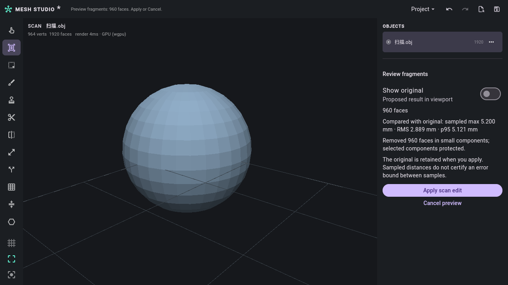

# mmx_studio

Flutter desktop front end for the `mmx_core` mesh kernel: a cross-platform
clean-room reimplementation of Autodesk Meshmixer 3.5.0's modelling and
fabrication workflow.

Part of the [mmx project](../../README.md). Licensed under Apache-2.0; see the
root [`LICENSE`](../../LICENSE) and [`NOTICE`](../../NOTICE).

## Features

- Import/export OBJ, PLY, STL, OFF and 3MF, plus native `.mix` scenes
  (multi-object import; export writes the selected object).
- Repair: weld, hole fill, non-manifold split, inspector.
- Remesh (isotropic, optional group-boundary preservation), reduce, Make Solid,
  hollow, booleans, offset.
- Edit tools: plane cut, mirror, extrude, separate shells, flip normals, Taubin
  smoothing, drop/center on bed, duplicate, combine, pattern arrays, primitive
  fitting, boundary-loop stitching, rigid ICP alignment onto a reference object,
  Extract, Make Part and Pivot.
- Stamps: analytic circle/ring/star/grid/noise height fields applied at the
  selection centroid.
- Analysis: wall thickness, overhang, stability, deviation, measurement,
  inter-object clearance.
- Fabrication: support forest, orientation, bed packing, slicing.
- Sculpt and face selection with dynamic refinement, undo/redo, export.
- Scan inspection, reversible cleanup previews, protected originals, sampled
  deviation limits, printer profiles, reports and reusable whole-mesh recipes.
- Empty startup and New Project with Save/Discard/Cancel and recovery-safe reset.

The tool matrix and the kernel-only/partial list are in
[`docs/TOOL-MATRIX.md`](../../docs/TOOL-MATRIX.md).

## Requirements

- Flutter 3.47.9 with its bundled Dart SDK, matching CI.
- Rust 1.99.1, Python 3.11+, and your platform's native build tools.
- Linux, macOS or Windows desktop target.

Follow the root [quick start](../../QUICKSTART.md) for platform setup.

## Run

From the repository root:

```sh
python3 start.py          # Windows: py -3 start.py
python3 start.py --debug  # Development with hot reload
```

Or, from this directory:

```sh
flutter pub get
flutter run -d linux        # or windows / macos
flutter build linux --release

# Optimized CLI + Studio, staged together under the root bin/builds/ directory:
make build
make package  # Portable unsigned archive with licenses and provenance
```

The Makefile in this directory forwards to the repository root. Windows without
Make can use `py -3 ../../tool/build.py`; build each desktop target on its native
OS. See [optimized builds](../../QUICKSTART.md#optimized-binaries-with-make).

On touch screens the viewport supports one-finger orbit and two-finger orbit +
pinch zoom. The properties panel collapses into a drawer below 900 px so the
same build works on a narrow desktop window. Android and iOS targets are
scaffolded; desktop CI covers Linux, Windows, and macOS.

## Start or replace a project

Studio starts empty, with **Import mesh** and **Open project** actions. Use
**Project → New project**, **Ctrl+N** on Linux/Windows, or **Command+N** on macOS
to start fresh. Unsaved work offers **Save**, **Discard**, and **Cancel**; Save
has initial focus and Escape cancels. A canceled or failed save keeps your
current work open.

New Project resets objects, selection, undo/redo, camera, source attachments and
the saved path. It waits for this session's pending recovery writes before
clearing its old recovery. Existing saved files and other sessions' recovery
files remain on disk. Tool settings and renderer preferences remain available.

## Scan to print

1. Import a mesh and confirm its physical units. The scene uses millimeters;
   3MF units are read from the file. Choose **Scan to print** in the toolbar.
2. Set the FDM/resin profile, bed dimensions, border, minimum wall and overhang
   assumptions. Inspect the findings and select affected geometry for review.
3. Preview fragment removal or bounded denoising. Selected components are
   protected from fragment removal; denoising pins boundaries and sharp creases.
   Reduce and remesh can operate on a selected region with its boundary pinned.
4. Review holes individually, preview a flat/smoothed patch or bridge, and trim
   with a numeric plane when needed. Caps preserve nested cavities. New patches
   receive an inferred-geometry face group.
5. Compare **Show original**, the proposed result and sampled distances at the
   same camera. **Apply scan edit** commits one undo step and retains a hidden,
   protected original. **Cancel preview** leaves the document unchanged.
6. Reinspect, place the model within the configured bed, and save an editable
   `.mmx` project. Export a preflight report alongside the printing mesh. Export
   a cleanup recipe only when the whole-mesh history is continuous from its
   retained original; regional or intervening unrecorded edits reject replay.



Observed Linux native integration capture, 2026-11-10, using a synthetic fixture.
Its measured distances include the deliberately removed component; this is a
workflow illustration, not a scan-quality benchmark.

The object menu supports rename, visibility, isolate, reference target and
deletion. Protected originals cannot be edited or deleted through those actions.
Below 900 logical pixels, open **Tool properties** to access the panel.

All new projects use schema 3, retaining scan history, originals and printer
settings. Schema 1/2 projects remain readable; earlier releases cannot open new
schema 3 files. Save a separate copy when preserving compatibility matters.

Deviation checks sample surfaces; they do not certify a global error bound.
Missing wall measurements remain unknown, and resin drainage and physical print
outcomes require further review. Unsupported UV/material topology edits reject
explicitly. See the [operation and recipe contracts](../../docs/CLI.md#scan-to-print-workflow),
[material limits](../../docs/MATERIALS.md), and
[commercial acceptance work](../../docs/PRODUCTION-READINESS.md#commercial-acceptance-work).

## Tests

```sh
flutter analyze
flutter test
```

The widget suite covers New Project, scan previews and replay guards, editing,
transforms, materials, undo, recovery, keyboard controls, and narrow layouts.
See [testing](../../docs/TESTING.md)
for native integration and renderer checks.

## Contributing

See the root [`CONTRIBUTING.md`](../../CONTRIBUTING.md) and
[`CODE_OF_CONDUCT.md`](../../CODE_OF_CONDUCT.md). Security reports follow
[`SECURITY.md`](../../SECURITY.md).
